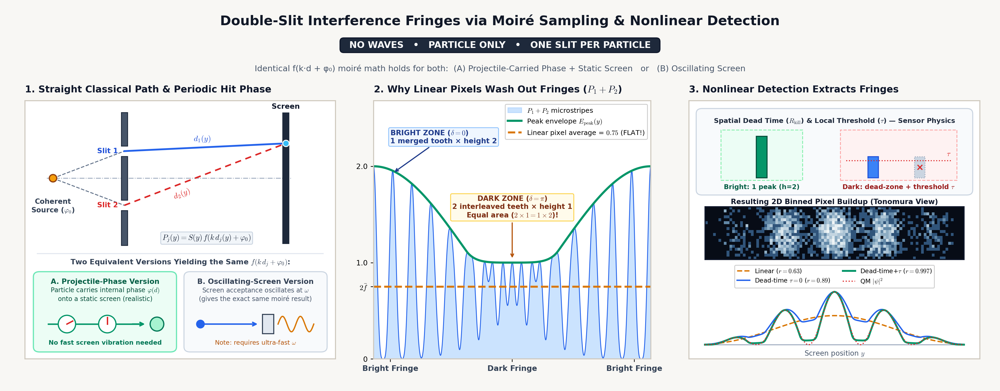

# Extracting Double-Slit Interference Envelopes from Classical Probability Combs via Moiré Sampling and Nonlinear Detector Memory

[](https://doi.org/10.5281/zenodo.24541000)

Companion simulation suite and interactive web application for:

**B. Sarioglu**, *"Extracting double-slit interference envelopes from classical probability combs via moiré sampling and nonlinear detector memory"* (2026) — **Preprint:** [https://doi.org/10.5281/zenodo.24541000](https://doi.org/10.5281/zenodo.24541000)

## [▶ Launch Interactive Web Explorer (with 2D Tonomura Buildup Screen)](https://baykalsarioglu.github.io/double-slit-moire/moire_explorer.html)



---

## Overview

Textbook impossibility arguments for the double-slit experiment conclude that adding single-slit classical probabilities (<i>P</i><sub>12</sub> = <i>P</i><sub>1</sub> + <i>P</i><sub>2</sub>) cannot produce interference fringes. This repository demonstrates the hidden premise behind that conclusion—**linear, memoryless pixel integration**—and provides a complete analytical and numerical toolkit for extracting interference envelopes from summed positive probability combs (**no waves · particle only · one slit per particle**):

1. **Multi-Harmonic Moiré Carrier Beat & Dual Phase Equivalence:** Summing two non-negative periodic acceptance combs <i>P<sub>j</sub></i>(<i>y</i>) = <i>S</i>(<i>y</i>) <i>f</i>(<i>k</i>·<i>d<sub>j</sub></i>(<i>y</i>) + φ<sub>0</sub>) generates a high-frequency spatial carrier whose upper envelope modulates at the exact double-slit interference phase δ(<i>y</i>) = <i>k</i> Δ<i>d</i>(<i>y</i>). Identical mathematics holds whether the periodic phase is carried internally by the projectile along its straight path onto a quasi-static screen (avoiding ultra-fast mechanical screen vibrations) or arises from oscillating detector acceptance.
2. **Exact Pitchfork Bifurcation & Analytical Envelope:** For <i>f</i>(θ) = [½(1 + cos θ)]<sup>2</sup>, the carrier peaks undergo a supercritical pitchfork bifurcation at ∣cos(δ/2)∣ = ½ (δ ≡ ±2π/3 mod 2π), yielding an exact piecewise closed-form peak envelope <i>E</i><sub>peak</sub>(<i>y</i>) with Pearson correlation <i>r</i>(<i>E</i><sub>peak</sub>, <i>I</i><sub>QM</sub>) = 0.892 and fringe visibility <i>V</i> ≈ 0.646.
3. **Asymptotic Low-Pass Erasure (Why Linear Pixels Fail):** Linear pixel integration over <i>W</i> ≫ λ<sub>dB</sub> cancels all oscillatory harmonics as <i>O</i>(λ<sub>dB</sub> / <i>W</i>), leaving the smooth classical sum 2<i>f&#x0304;</i> <i>S</i>(<i>y</i>) (<i>r</i> = 0.626).
4. **Nonlinear Detection (Spatial Dead Time & Local Thresholding):** Standard physical sensor nonlinearities—spatial dead time (<i>R</i><sub>kill</sub> ≫ λ<sub>dB</sub>) and local baseline thresholding calibrated to the mean arrival rate (Θ = 2<i>f&#x0304;</i> <i>S</i>(<i>y</i>))—act as a spatial envelope detector, reaching <i>r</i> = 0.988–0.997 and restoring unit fringe visibility (<i>V</i> → 1.00).

---

## Repository Structure

```text
├── moire_explorer.html                   # Interactive browser-based simulation (HTML5 Canvas)
├── simulations/
│   ├── generate_fig_setup.py             # Fig. 1: Geometric setup & active detector schematic
│   ├── generate_fig1.py                  # Fig. 2: Slit 1, Slit 2, and moiré sum P1 + P2 vs QM
│   ├── generate_fig_screen_memory.py     # Fig. 3: Linear readout (r=0.625) vs lateral depletion (r=0.891)
│   ├── generate_fig_func_sweep.py        # Fig. 4 & Table 1: Six periodic acceptance profiles f(θ)
│   ├── generate_fig_convergence.py       # Table 2: Convergence across microstripe density k
│   └── generate_fig_coherence.py         # Fig. 5: Coherent vs incoherent source-detector phase
└── LICENSE                               # MIT License
```

## Reproducing the Figures and Tables

Requires Python 3.9+ with `numpy`, `scipy`, and `matplotlib`:

```bash
pip install numpy scipy matplotlib
python3 simulations/generate_fig_setup.py
python3 simulations/generate_fig1.py
python3 simulations/generate_fig_screen_memory.py
python3 simulations/generate_fig_func_sweep.py
python3 simulations/generate_fig_convergence.py
python3 simulations/generate_fig_coherence.py
```

## License

MIT License — Copyright (c) 2026 Baykal Sarioglu
